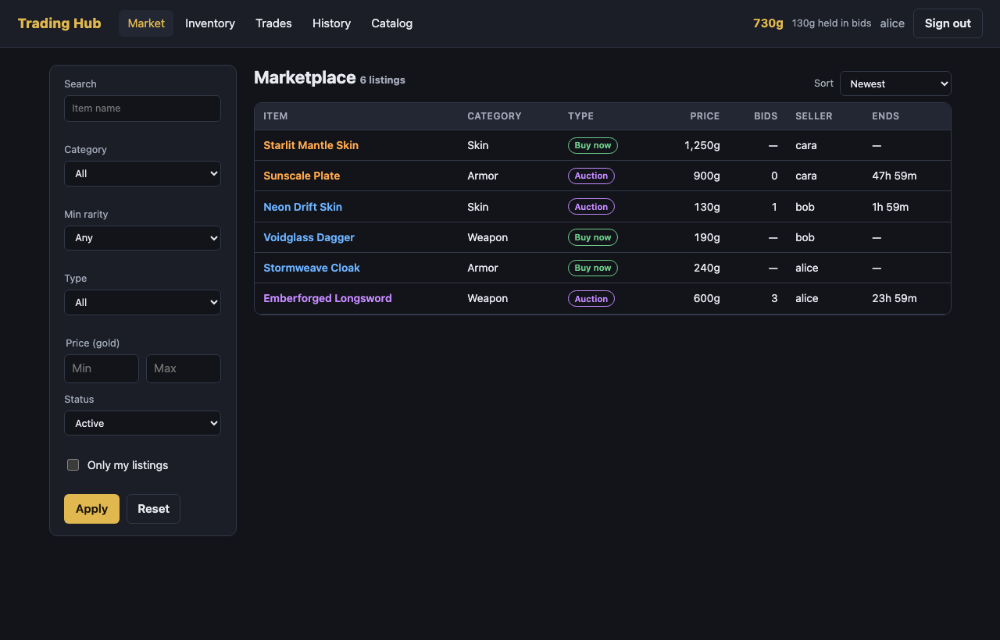

# Midterm: Trading Hub

Ryan Thomas Stoffel · CSCI3210 · Fall 2026 · Project 4 (Trading Hub and Virtual Item Marketplace)

Players list virtual items at a fixed price or as timed auctions, bid against each other, buy outright, and
barter items directly. All gold and item movement happens in locked database transactions so two players
cannot spend the same gold or buy the same item.



Stack: Django 6 + Django REST Framework (token auth, SQLite) in `backend/`, React 19 + TypeScript + Vite in
`frontend/`.

## Run

```sh
# Backend: http://127.0.0.1:8000
cd backend
uv venv --python 3.12 && uv pip install -r requirements.txt   # or python -m venv .venv && pip install -r requirements.txt
cp .env.example .env                                           # set DJANGO_SECRET_KEY
.venv/bin/python manage.py migrate
.venv/bin/python manage.py seed                                # demo players alice, bob, cara, admin
.venv/bin/python manage.py runserver

# Frontend: http://localhost:5173 (proxies /api to the backend)
cd frontend
cp .env.example .env
npm install
npm run dev
```

Demo password for every seeded account: `tradehub-demo`. `admin` is staff and can edit the item catalog.

## Features

Each feature lists the requirement it satisfies and its screenshot.

| # | Feature | Requirement | Screenshot |
| --- | --- | --- | --- |
| 1 | **Registration.** New accounts get a wallet with 1,000 gold and three random starter items. Username and password are validated server-side and errors show inline. | Players must have an account and a starting economy. | [01a](screenshots/01a-register-validation.png), [01b](screenshots/01b-register-starter-inventory.png) |
| 2 | **Token sign-in and sign-out.** DRF token auth. The token is stored client-side and a 401 anywhere signs the user out. | Secure authentication. | [02](screenshots/02-login-error.png) |
| 3 | **Wallet.** The header shows spendable gold and gold held by the player's live bids. | Players must see their balance before spending. | [03](screenshots/03-marketplace-and-wallet.png) |
| 4 | **Inventory.** Grid of owned items with rarity, category, and whether each is listed. | Players must see what they own. | [04](screenshots/04-inventory.png) |
| 5 | **Item catalog with admin role.** Every item type is readable by players. Only staff can add types (`IsAdminOrReadOnly`). | Role-based permissions. | [05](screenshots/05-item-catalog-admin.png) |
| 6 | **Fixed-price listings.** List an owned item for a set price. A database constraint blocks listing one item twice. | Items can be listed for sale. | [06a](screenshots/06a-create-fixed-listing.png), [06b](screenshots/06b-fixed-listing-created.png) |
| 7 | **Auction listings.** Opening bid and a 1-72 hour duration. | Items can be bid on. | [07a](screenshots/07a-create-auction.png), [07b](screenshots/07b-auction-created.png) |
| 8 | **Marketplace search and filters.** Name search, category, minimum rarity, type, price range, status, "only mine", five sort orders, and pagination. Filters are validated by a serializer and kept in the URL. | Listings can be filtered. | [08](screenshots/08-marketplace-filters.png) |
| 9 | **Listing detail and bid history.** Current price, minimum next bid, live countdown, and every bid. | Players can inspect a listing before acting. | [09](screenshots/09-auction-detail-bid-history.png) |
| 10 | **Bidding with gold escrow.** A bid must beat the top bid by 5%. The bid amount is held from the bidder and the previous top bidder is refunded in the same transaction. | Bids must not double-spend. | [10](screenshots/10-place-bid.png) |
| 11 | **Buy now.** Moves gold buyer to seller and the item seller to buyer atomically. Insufficient gold returns a clear error. | Secure transactions between players. | [11a](screenshots/11a-buy-now.png), [11b](screenshots/11b-buy-now-insufficient-gold.png) |
| 12 | **Cancel listing.** Seller only, and only before the first bid. | Sellers control their listings. | [12](screenshots/12-cancel-listing.png) |
| 13 | **Auction settlement.** Ended auctions close on the next request: the winner gets the item and the seller gets the held gold. Unbid auctions expire. | Auctions must resolve. | [13](screenshots/13-auction-settled.png) |
| 14 | **Barter trades.** Offer any of your items for any of another player's. The recipient accepts or declines, the sender can withdraw. Acceptance re-checks ownership under lock. | Barter between players. | [14a](screenshots/14a-incoming-trade.png), [14b](screenshots/14b-new-trade-offer.png), [14c](screenshots/14c-trade-sent.png), [14d](screenshots/14d-trade-accepted.png) |
| 15 | **Transaction history.** Ledger of every gold change and trade with the running balance. | Players can audit their account. | [15](screenshots/15-transaction-history.png) |

Error handling across features: [404 page](screenshots/16-error-404.png), [401 toast](screenshots/02-login-error.png),
[400 inline errors](screenshots/01a-register-validation.png), [400 toast](screenshots/11b-buy-now-insufficient-gold.png).

## Rubric map

1. **Backend and DB.** `backend/market/models.py`. One-to-one `Profile`→`User`, foreign keys throughout,
   many-to-many `TradeOffer.offered_items` / `requested_items`. Constraints: one active listing per item,
   auctions need an end time, no self-trades. `Listing.objects.with_market_data()` annotates the top bid,
   bidder, and bid count in one query, and views use `select_related` / `prefetch_related` to avoid N+1.
2. **API and auth.** `serializers.py`, `views.py`, `urls.py`. `DefaultRouter` viewsets with `@action`
   endpoints (`/listings/{id}/bid/`, `/buy/`, `/cancel/`, `/trades/{id}/accept/`, ...). Token auth,
   `IsAuthenticated` by default, `IsAdminOrReadOnly` on the catalog, and owner checks in `services.py`.
3. **React and TypeScript.** Pages in `frontend/src/pages` fetch data and own state. Components in
   `frontend/src/components` only render props. `src/types.ts` types every payload. `strict` is on and
   `oxlint` fails on `any`.
4. **State and API client.** `AuthContext` (user, wallet) and `ToastContext` (stable `notify`, the toast list
   re-renders only its provider). All requests go through `src/api/client.ts` and `src/api/market.ts`.
   `TimeLeft` ticks in isolation so tables do not re-render every second.
5. **Errors and resilience.** `ApiError` maps 400/401/403/404/409/500 to inline field errors or toasts.
   `ErrorBoundary` catches render crashes. Backend: every gold or item change is in `transaction.atomic`
   with `select_for_update`, and `exceptions.handler` returns JSON for integrity errors and unexpected
   crashes.
6. **Organization.** Separate `backend/` and `frontend/`, `.env.example` for both, `.gitignore` excludes
   `.env`, databases, and build output.

Concurrency note: SQLite ignores `select_for_update`, so the database uses `transaction_mode: IMMEDIATE`,
which makes each transaction take the write lock up front. Concurrent bids and purchases serialize on
SQLite, and the same code locks rows on PostgreSQL.

## Checks

```sh
cd backend && .venv/bin/python manage.py test market   # 10 API tests: escrow, refunds, settlement, guards, trades
cd frontend && npm run lint && npm run build
```

`scripts/screenshots.mjs` drives a freshly seeded app in Chromium and recreates `screenshots/`. Set
`PLAYWRIGHT_MODULE` and `PLAYWRIGHT_CHROMIUM_EXECUTABLE` to use an existing Playwright install.
